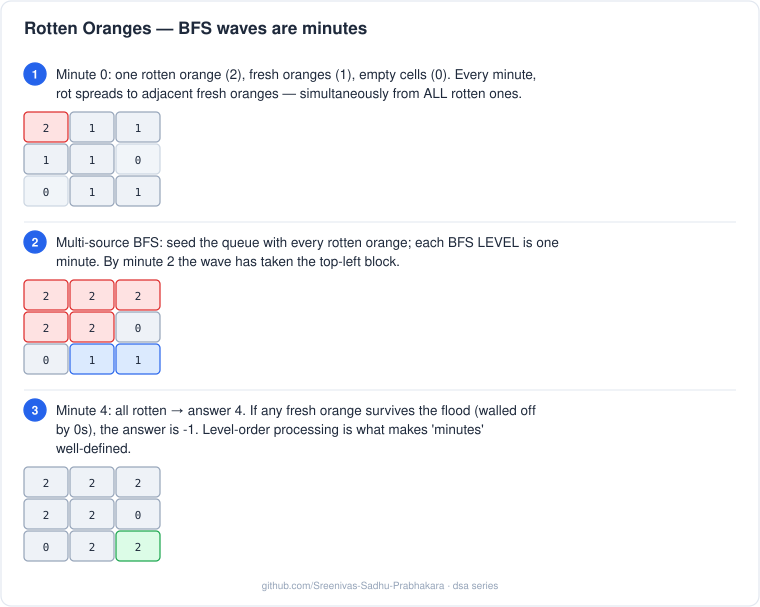

# Rotten Oranges (BFS)

> Striver SDE Sheet 088 · Day 14 Stack & Queue II — multi-source BFS: seed the queue with every rotten orange, each queue generation is one minute. Go, stdlib only, tested.

## Problem

A grid holds fresh oranges (1), rotten ones (2) and gaps (0). Every minute, rot spreads to 4-adjacent fresh oranges. How many minutes until nothing fresh remains — or -1 if some orange is unreachable?

## Approach

Simultaneous spreading from many points is **multi-source BFS**: load *all* rotten oranges into the initial queue, then expand generation by generation — each full wave is one minute, so time is counted per level, not per cell. Marking a fresh orange rotten the moment it's enqueued (not when dequeued) prevents double-infection. A fresh-orange counter answers both end conditions at once: zero means done (loop count = minutes), nonzero after the queue dies means isolated oranges — the -1 case the problem is really testing.

**Complexity:** O(R·C) time and space — each cell enters the queue at most once.

## Visual walkthrough

Read the picture top to bottom — each numbered frame is one moment of the algorithm
running on this repo's test example.

## Run

    go test ./...   # verify
    go run .        # demo

---

One of 191 repos solving Striver's SDE Sheet in Go — stdlib only, one problem per repo, every solution tested. Browse the set: [`dsa-*` repos](https://github.com/Sreenivas-Sadhu-Prabhakara?tab=repositories&q=dsa-&type=source).
